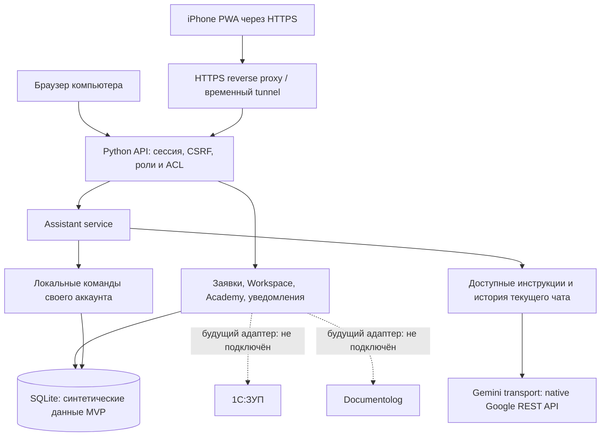

# Архитектура JanaМен 1.4 · Команда №45

## Фактическая реализация
- `server.py`: Python stdlib HTTP server, API, сессии, CSRF и запуск/схема SQLite.
- `platform_service.py`: серверные роли и права, заявки, команды, Workspace, обучение и сервисы.
- `assistant_service.py`: контекст чата, локальные аккаунтные команды, проверки доступа.
- `ai_config.py`: локальные настройки и ключ, не передаваемый браузеру.
- `gemini_transport.py`: models/generateContent Google REST API, TLS и явные ошибки, без скрытой шаблонной подмены.
- `static/`: единый адаптивный интерфейс; `mobile.js/css` — мобильная оболочка и формы.
- Изменения опрашиваются примерно раз в 3 секунды в активном приложении; при возврате обновление возобновляется. Это polling, не WebSocket; push нет.
- SW кеширует только публичные offline-ресурсы/иконки. API и кадровые данные для офлайн-просмотра не кешируются, действия офлайн не отправляются.

## Будущие интеграции — проект, не готовые подключения
1С:ЗУП предполагается источником официальных кадровых данных и остатков. Будущий серверный адаптер получает данные с проверкой доступа и сохраняет происхождение/время обновления; обычный сотрудник не меняет официальные поля напрямую.
Documentolog предполагается внешним документооборотом. Будущий серверный адаптер отправляет согласованный документ и принимает проверяемый статус. Создание текста в MVP не равно юридической подписи.
У этих систем сейчас нет рабочих production-коннекторов, синхронизации или ЭЦП в MVP. Данные демонстрационные.

## Границы безопасности и проверки
ИИ не выполняет кадровые решения и не изменяет данные. Явные команды своего аккаунта обрабатываются локально; текст свободного чата и доступные инструкции передаются Google. Не вводите в чат секреты или персональные данные.
Обычный Gemini chat не гарантирует строгое «ответ только по базе»; это ограничение отмечено в README.
Учебный сервер требует отдельного аудита и производственной инфраструктуры до работы с реальными кадровыми данными. 151 локальный тест и браузерная эмуляция не являются промышленной сертификацией; физический Safari и публичный deployment здесь не проверены.
